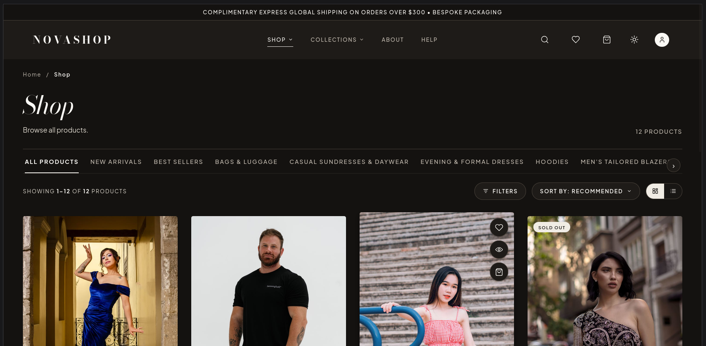
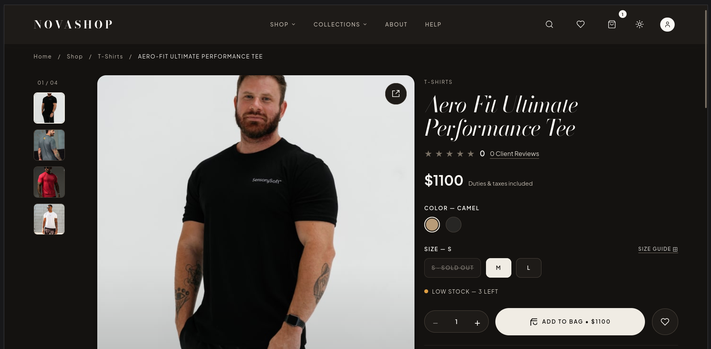
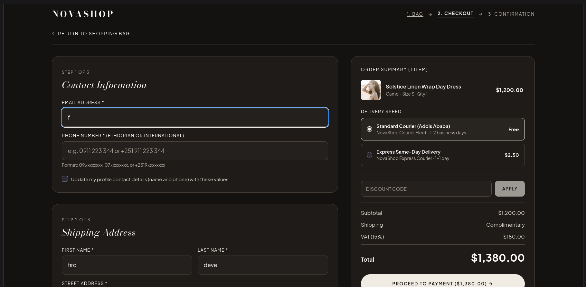
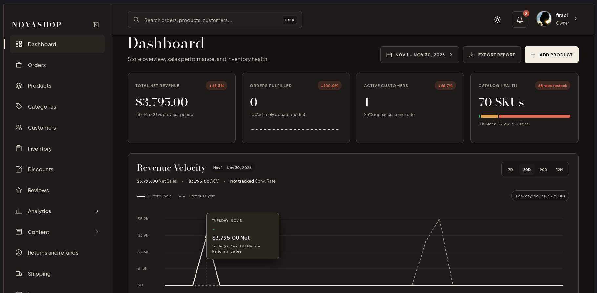

<h1 align="center">NovaShop</h1>

<p align="center">
<strong>A modern fashion e-commerce platform built with React, Node.js, Express, and MongoDB.</strong>
</p>

<p align="center">
  
  
  
  
  
  
  
  
  
</p>

NovaShop is a full-stack fashion e-commerce platform that pairs a premium, minimalist storefront with a comprehensive administration dashboard. It covers the full shopping journey (browsing, cart, checkout, payment, order tracking) and the back-office work behind it (catalog, inventory, orders, returns, shipping, content, and support).

## Table of Contents

- [Screenshots](#screenshots)
- [Features](#features)
- [Tech Stack](#tech-stack)
- [Project Structure](#project-structure)
- [Getting Started](#getting-started)
- [Environment Variables](#environment-variables)
- [API Documentation](#api-documentation)
- [Testing](#testing)
- [Security Considerations](#security-considerations)
- [Deployment Considerations](#deployment-considerations)
- [Possible Future Improvements](#possible-future-improvements)
- [Author](#author)

## Screenshots

### Homepage
Premium storefront with a hero section.


### Shop
Product catalog with category tabs, filters, sorting, and grid/list views.



### Product Details
Image gallery, color and size selection, stock status, and add-to-bag.



### Shopping Bag
Slide-out bag with quantity controls and order summary.


### Checkout
Multi-step checkout with contact details, shipping address, delivery options, and order summary.



### Admin Dashboard
Administration interface with business analytics and revenue overview.



> Screenshots use seeded demo data.

## Features

### Customer Storefront

- Premium fashion homepage
- Product catalog and collections
- Product search, filtering, sorting, and pagination
- Product details and image galleries
- Shopping cart and wishlist
- Customer registration and login
- Customer profile management and saved addresses
- Checkout and payment processing (Chapa)
- Order history, order details, and order tracking
- Product reviews
- Discount and coupon management
- Newsletter subscription
- Help center and customer support

### Administration Dashboard

- Admin authentication and authorization
- Dashboard and business analytics
- Product and category management
- Customer management
- Inventory and stock management
- Order management
- Discount management
- Review management
- Returns and refunds
- Payment management
- Shipping zones and shipping methods
- Homepage content and hero slide management
- Media library
- Customer support management
- Notifications
- Admin profile and settings

## Tech Stack

| Layer | Technologies |
|---|---|
| Frontend | React 19, Vite 8, Tailwind CSS 4, JavaScript, Axios |
| Backend | Node.js, Express 5, MongoDB, Mongoose |
| Authentication | JWT access tokens, refresh tokens in HttpOnly cookies, role-based access control (RBAC) |
| Payments | Chapa |
| Media | Cloudinary |
| Background jobs | Redis, BullMQ |
| Email | Nodemailer (outbound), IMAP (inbound customer-support email) |
| API docs | Swagger |
| Testing | Jest, Supertest (backend) |

## Project Structure

<!-- VERIFY: folder names below are assumed. Adjust to match the repository. -->

```text
NovaShop/
├── frontend/                 # React + Vite storefront and admin interface
│   ├── src/
│   └── package.json
├── backend/                 # Express API
│   ├── src/
│   ├── tests/
│   ├── .env.example
│   └── package.json
├── docs/
│   └── screenshots/        # README images
└── README.md
```

## Getting Started

### Prerequisites

- Node.js (current LTS recommended)
- npm
- A MongoDB instance (local or hosted)
- A Redis instance (required for BullMQ background jobs)
- Accounts and credentials for the integrations you want to use: Chapa, Cloudinary, and an SMTP/IMAP mailbox

### 1. Clone the repository

<!-- VERIFY: repository URL -->

```bash
git clone https://github.com/firaol-siraj/NovaShop.git
cd NovaShop
```

### 2. Configure and run the backend

```bash
cd backend
npm install
cp .env.example .env     # then fill in your own values
npm run dev
```

### 3. Configure and run the frontend

```bash
cd frontend
npm install
cp .env.example .env     # if the frontend provides one
npm run dev
```

<!-- VERIFY: script names (dev, test, build) match each package.json -->

The Vite dev server prints the local storefront URL when it starts. The backend port is set in your backend `.env`.

## Environment Variables

Configuration is read from environment variables. Copy `.env.example` to `.env` and fill in your own values. **Never commit `.env` files or real credentials.**

<!-- VERIFY: variable names below are illustrative. Keep this table in sync with backend/.env.example -->

| Variable | Purpose |
|---|---|
| `PORT` | API server port |
| `MONGODB_URI` | MongoDB connection string |
| `JWT_ACCESS_SECRET` | Secret used to sign access tokens |
| `JWT_REFRESH_SECRET` | Secret used to sign refresh tokens |
| `CHAPA_SECRET_KEY` | Chapa API credential (use test keys in development) |
| `CLOUDINARY_CLOUD_NAME`, `CLOUDINARY_API_KEY`, `CLOUDINARY_API_SECRET` | Cloudinary media credentials |
| `REDIS_URL` | Redis connection for BullMQ queues |
| `SMTP_HOST`, `SMTP_PORT`, `SMTP_USER`, `SMTP_PASS` | Outbound email via Nodemailer |
| `IMAP_HOST`, `IMAP_PORT`, `IMAP_USER`, `IMAP_PASS` | Inbound customer-support mailbox |

The frontend `.env.example`, if present, typically holds the API base URL. Variables exposed to a Vite client are public, so never place secrets in them.

## API Documentation

The backend exposes a REST API documented with Swagger. With the server running, open the Swagger UI in your browser to browse and try the endpoints.

<!-- VERIFY: Swagger route -->

```text
http://localhost:<PORT>/api-docs
```

Protected endpoints use JWT access tokens. Admin endpoints are restricted by role-based access control.

## Testing

Backend tests use Jest and Supertest.

```bash
cd backend
npm test
```

## Security Considerations

- **Authentication:** JWT access tokens with refresh tokens stored in HttpOnly cookies, which keeps refresh tokens out of reach of client-side JavaScript.
- **Authorization:** role-based access control separates customer and administrator capabilities.
- **Secrets:** all credentials are supplied through environment variables; only `.env.example` is committed.
- **Payments:** payment processing is delegated to Chapa, so the application does not handle raw card data.
- **Recommended before production:** HTTPS everywhere, `Secure` and `SameSite` cookie settings, restrictive CORS, rate limiting on authentication routes, dependency auditing (`npm audit`), and rotating any key that has ever been exposed.

## Deployment Considerations

NovaShop is not currently deployed. If you deploy it, plan for the following:

- **Frontend:** build with `npm run build` and serve the static output from any static host or CDN.
- **Backend:** run the Express API on a Node.js host with production environment variables.
- **Data and queues:** a managed MongoDB cluster and a managed Redis instance.
- **Background workers:** BullMQ workers need Redis to be reachable from wherever they run.
- **Payments:** switch Chapa from test to live credentials only after end-to-end verification.
- **Networking:** configure CORS and cookie domains for your production frontend and API origins.

## Possible Future Improvements

These are ideas, not implemented features:

- Containerization with Docker and Docker Compose
- Continuous integration for linting and tests
- Frontend and end-to-end test coverage
- Production deployment with documented environments

## Author

**Firaol Siraj**
GitHub: [@firaol-siraj](https://github.com/firaol-siraj)
